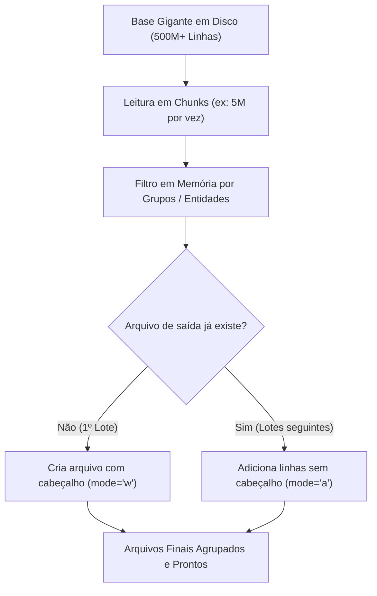

# ⚡ Pipeline de Processamento em Chunks (Big Data Single-Node)

> **Projeto de Conclusão / Pitch de Avaliação**  
> **Curso:** MBA em Big Data e Inteligência Competitiva  
> **Disciplina:** Ferramentas para Big Data  
> **Conceito Aplicado:** Paradigma *"Dividir para Conquistar"* (*Divide and Conquer*)

---

## 📌 Contexto e Problema de Negócio

No ambiente corporativo, nos deparamos com bases volumosas de dados (mais de **500 milhões de registros** em arquivos CSV de telemetria/logs) que precisavam ser filtradas, agrupadas e redistribuídas para alimentar relatórios e visões analíticas.

### O Gargalo:
* **Estouro de Memória (*MemoryError / OOM*):** A leitura tradicional carregando a base inteira em memória (`pd.read_csv`) travava o servidor, mesmo em máquinas virtuais com boa quantidade de memória RAM.
* **Restrição de Infraestrutura:** O projeto precisava rodar em uma **máquina única (Single-Node)**, sem a disponibilidade ou viabilidade financeira de provisionar clusters distribuídos complexos (como Apache Spark ou Databricks em nuvem).

---

## 💡 A Solução: Paradigma "Dividir para Conquistar"

Inspirado no conceito fundamental do **MapReduce / Hadoop**, implementei este pipeline que quebra o processamento massivo em lotes gerenciáveis (*chunks*):

1. **Leitura Paginada em Memória:** Processa fatias controladas de dados (ex: blocos de 5.000.000 de linhas).
2. **Filtragem & Segmentação:** Aplica as regras de negócio e mapeamento de grupos em cada lote isoladamente.
3. **Escrita Incremental Inteligente (*Append* Dinâmico):**
   * **1º Chunk:** Cria o arquivo CSV de destino com o cabeçalho (`mode='w'`, `header=True`).
   * **Chunks Seguintes:** Rastreia os arquivos já iniciados e realiza a gravação incremental contínua (`mode='a'`, `header=False`), evitando duplicidade de cabeçalhos.



---

## 🚀 Como Executar Localmente

### 1. Clonar e Instalar Dependências

```bash
git clone https://github.com/eedsvie/smart-chunk-pipeline.git
cd smart-chunk-pipeline
pip install -r requirements.txt
```

### 2. Rodar o Teste Rápido de Demonstração

O script `demo.py` gera automaticamente 1 milhão de linhas fictícias de telemetria e executa o fatiamento e agrupamento para validar a lógica:

```bash
python demo.py
```

### 3. Usar com Seus Próprios Dados

Edite as variáveis no arquivo [`pipeline.py`](pipeline.py):

```python
PASTA_ENTRADA = "./dados/origem_visoes"
PASTA_SAIDA = "./dados/saida_processada"
TAMANHO_CHUNK = 5_000_000  # Ajuste conforme a RAM da sua máquina

# Defina seus grupos e regras
GRUPOS_REGRAS = {
    "grupo_alpha": ["dispositivo_01", "dispositivo_02"],
    "grupo_beta":  ["dispositivo_03", "dispositivo_04"]
}
```

E execute:
```bash
python pipeline.py
```

---

## 📊 Vantagens da Abordagem

* **Consumo de Memória Constante $O(1)$:** A pegada de RAM não cresce com o tamanho do arquivo — ela fica limitada apenas ao tamanho do *chunk* configurado.
* **Custo Zero de Infraestrutura Adicional:** Viabiliza o processamento de centenas de milhões de registros no hardware existente.
* **Agnóstico a Linguagem:** A mesma lógica de paginação, controle de estado e append pode ser replicada em R, Java, Node.js ou qualquer outra stack.

---

## 📄 Licença

Distribuído sob a licença MIT. Veja o arquivo `LICENSE` para mais detalhes.
